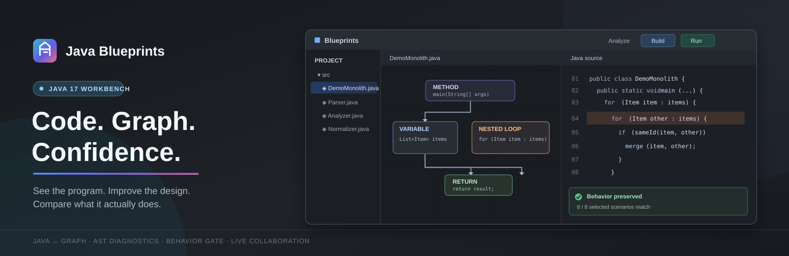

<div align="center">



# Java Blueprints

**Understand a Java monolith. Change it visually. Keep its behavior under control.**

Windows desktop workbench for the 2026 hackathon case: Java 17 source editor, editable program graph, AST diagnostics, verified example refactoring, and live shared projects.

[Quick start](#quick-start) · [Three-minute demo](#three-minute-demo) · [Build](#build-from-source) · [Architecture](docs/ARCHITECTURE.md) · [Case coverage](docs/CASE.md)

</div>

> **По-русски:** Java Blueprints превращает Java-код в редактируемую схему, связывает узлы со строками исходника, находит проблемные фрагменты и проверяет результат изменений на выбранных входах. Готовая Windows-сборка содержит Java 17. Совместный доступ позволяет работать над кодом и схемой в одном проекте.

## What you can do

| Workspace | Analysis | Changes | Confidence | Collaboration |
| --- | --- | --- | --- | --- |
| Open a multi-file `.java` project; navigate source and graph side by side | Java Compiler Tree API provides structure, source ranges, nested-loop diagnostics and estimated Big O | Edit graph fields or exact source fragments; undo, layout, zoom, Fit to content | Compile and run locally; compare exit code, stdout and stderr; automatic regression indicator and counterexample search | Invite editors or viewers; live Java text, graph positions, presence and cursors; disk-backed rooms |

The **1,000-line case demo** contains a nested search (`O(n²)` for the repeated traversal). **Improve example** replaces it with a `HashMap` index and splits responsibilities into `Parser.java`, `Analyzer.java`, `Normalizer.java`, and a small entry point. The proposal is applied only after selected behavior checks pass. Other Java files have an AST-backed graph and a guarded **Extract method** action; the demo transformation is not a universal optimizer.

## Quick start

### Run the Windows app

Build the `.exe` below. When a GitHub release is attached, its installer is the quickest option. The installed app includes its Java 17 compiler and runtime; end users do not need a separate JDK. `dist/win-unpacked/Java Blueprints.exe` is the unpacked local build. The installer is currently unsigned.

### Build from source

Requirements: **Windows x64**, **Node.js 22+**, **pnpm 10+**, and a **JDK 17 x64** with `jlink`. The generated `runtime/` image is intentionally excluded from Git.

```powershell
# Set JAVA_HOME to the JDK 17 directory before running these commands.
& "$env:JAVA_HOME\bin\jlink.exe" `
  --add-modules java.se,jdk.compiler,jdk.unsupported,jdk.zipfs `
  --strip-debug --no-header-files --no-man-pages `
  --output runtime

pnpm install --frozen-lockfile
pnpm start       # run from source
pnpm dist        # create dist/Java Blueprints Setup <version>.exe
```

`pnpm start` and `pnpm dist` compile the Java analyzer and bundle the collaboration client. `scripts/build-analyzer.cjs` uses `runtime/bin/javac.exe`.

## Three-minute demo

1. Select **File → Load 1,000-Line Case Demo**. The sample has 1,000+ lines and repeatedly scans a collection.
2. Select **Analyze Project**. Open a finding to jump to its source line and graph card. **Structure** shows class, method, loop and condition ranges.
3. Inspect the graph. Edit a supported card field or source fragment and watch the Java text change. Arrange the diagram or Fit to content.
4. Select **Improve example**. A `HashMap` index and four-file split are proposed, compiled, checked on configured inputs, and applied only when all checks pass.
5. Open **Behavior check**. Inspect exit status, stdout and stderr. Change an output string; the automatic indicator reports a mismatch. **Find Counterexample** searches and minimizes a revealing input.
6. Select **Share**. Invite another editor or a viewer to see live text, graph moves and presence.

The prepared demo uses **8 behavior scenarios**. They are concrete evidence, not a proof of equivalence for every input. [Full operator script and case mapping →](docs/CASE.md)

## Verification

Build the installer first. Then run these acceptance commands against the unpacked executable:

```powershell
pnpm smoke
pnpm acceptance:large
pnpm acceptance:collaboration
pnpm acceptance:collaboration-desktop
```

`smoke` covers demo diagnosis, guarded optimization, matching cases, regression detection and counterexample search. `acceptance:large` exercises a 1,006-line Java file, graph editing, undo/redo and extraction. `acceptance:collaboration` checks three clients, concurrent text convergence, viewer protection and disk persistence. `acceptance:collaboration-desktop` checks the desktop client with a local room. [Evidence details →](docs/CASE.md)

## Collaboration

**Share → Create shared project** requires a workspace access key. The room owner can copy separate editor and viewer invitations. Installed Windows clients handle `java-blueprints://` links; invitation codes can also be pasted in the Share dialog. Source, graph positions and CRDT state live on the server's disk. Capability tokens are stored as hashes server-side and in encrypted Windows app storage client-side.

The app has a default HTTPS collaboration endpoint; the Share dialog also accepts a self-hosted address. No server or room key is in this repository. [`collaboration-server/`](collaboration-server/README.md) is a separate Node 20+ process. Public deployments need an HTTPS reverse proxy with WebSocket upgrade, dedicated service account and protected data directory.

## Scope and honest limits

- The bundled Java 17 runtime covers the mandatory case language and standard libraries, including `java.lang`, console I/O, collections and exceptions. Graph editing of every possible construct is not claimed. The case excludes concurrency, reflection, filesystem, networking and time APIs from evaluation.
- Big O is a **heuristic estimate** from Java AST patterns. Arbitrary program complexity cannot be decided automatically.
- Structured graph fields cover recognized constructs. AST fallback cards expose exact source fragments. Complex Java may be easier to change in source view.
- **Improve example** targets the bundled unchanged demo. **Extract method** supports eligible standalone static methods and rejects proposals that fail compilation or configured behavior checks.
- Behavior checks compare console `main` execution on chosen stdin samples: exit code, stdout and stderr. They do not prove equivalence for all inputs or external side effects. Compilation and execution have a 20-second process limit.
- Local import accepts up to 200 Java files of up to 2 MiB each. The collaboration service has separate project limits in its [guide](collaboration-server/README.md).
- Java programs run locally with the current user's OS permissions. Open and run only code you trust.

## Project map

```text
index.html / features.css          IDE workspace and visual graph
features.js                         project operations, analysis UI, demo and behavior workflow
workbench-actions.js / ui-en.js     menus, commands and English interface strings
analyzer/JavaAnalyzer.java          Java Compiler Tree API analysis
electron/                           lifecycle, IPC, Java build/run and protected storage
collaboration-client-entry.js       Yjs desktop client source
collaboration-server/               independent, disk-backed WebSocket service
scripts/                            build and acceptance entry points
docs/                               architecture and case mapping
```

### Credits and licensing

Built for the Axenix Java Blueprints case. JetBrains Mono is distributed under its [SIL Open Font License](assets/fonts/JetBrainsMono-OFL.txt). This independent workbench is not affiliated with JetBrains. No open-source license for application source has been selected; reuse terms should be agreed with the project owner.
