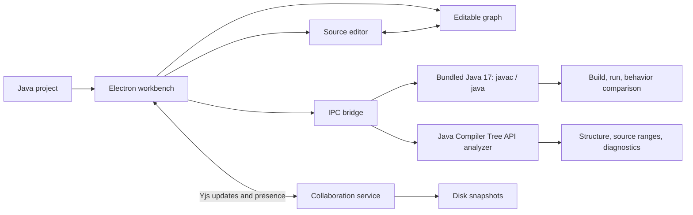

# Architecture

Java Blueprints has two independently runnable pieces: a Windows Electron workbench and an optional collaboration service.

## Desktop boundaries

- The renderer owns the project tree, code editor, graph, diagnostics pane, behavior cases and demo workflow.
- `electron/preload.cjs` exposes a narrow bridge to the renderer. `electron/main.cjs` handles file dialogs, persistence, single-instance invitation links and encrypted local collaboration credentials.
- `electron/java.cjs` creates temporary Java workspaces for analysis, compilation, execution and version comparison. The app packages Java 17; end users do not install a JDK.
- `analyzer/JavaAnalyzer.java` uses the JDK compiler tree API. It emits source ranges, structure and pattern-based diagnostics rather than trying to infer every Java property from text.
- Graph and source stay linked for supported constructs. Other AST nodes expose their exact source fragment so users can edit without losing unrecognized syntax.

## Behavior gate

The original file set is kept as a baseline. For each selected stdin sample, the runner compiles and starts baseline and candidate programs with the configured main class. It compares exit code, stdout and stderr. A demo optimization or eligible method extraction is committed only after a successful candidate build and matching selected cases. After later edits, automatic checking can detect regressions; counterexample search generates and reduces extra inputs. This is evidence over a finite set, not a formal proof of equivalence.

## Collaboration boundaries

The workbench stores Java file contents in Yjs text values and graph positions in a Yjs map. The Node service authenticates owner/editor/viewer capabilities, merges updates, broadcasts presence and writes each accepted state to its data directory. Java code is stored as data on the server; it is compiled and executed on the local desktop only. Viewer tokens cannot submit CRDT writes. Owner keys and workspace access keys are never committed to source control.

The service is designed for one process per data directory. See its [deployment and protocol guide](../collaboration-server/README.md) for limits, endpoints and reverse proxy requirements.
